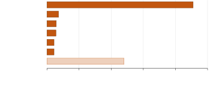
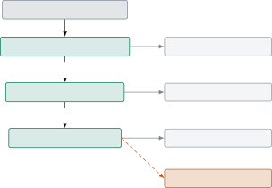

# CAST: A Deployed Speech-to-Text Cascade for Closed Captioning of Entertainment Television

Aditya Mishra    Thanish Bolla    Bidisha Sharma    Balaji Pitchaikannu
   Surbhi Sinha    Anup Kotalwar

###### Abstract

Despite rapid progress in automatic speech recognition (ASR), caption
generation for long-form entertainment video remains challenging for
content dense in music and effects, rich in accents, crosstalk, and
noise. The transcript quality depends on segmentation and surrounding
modules as much as the acoustic model. A single pass voice activity
detection (VAD) can miss faint, low-energy voice while forwarding
near-silent segments that induce hallucination and repetition in an
autoregressive decoder. These competing errors motivate a hierarchical
VAD that revisits rejected segments under semantic and acoustic
retention checks. We present Captioning ASR Stack for Television (CAST),
an integrated speech-to-text pipeline for closed captioning (CC)
combining frozen Whisper large-v3 with segmentation, language
identification, lyrics routing, and targeted hallucination detection and
repair on a single NVIDIA L4 GPU. On 100 in-house assets spanning 60.46
hours, CAST reduces normalized WER from 6.99% to 5.36% and subtitle edit
rate from 254.2 to 221.9 min/hour against the WhisperX pipeline, and
improves deletion rate by 11% on public datasets. We also present the
behavior of each stage in the pipeline. CAST entered the production
speech-to-text (STT) stage of our CC pipeline in late August 2026; we
report the evaluation evidence and path to full-scale operation.

Warner Brothers Discovery

{aditya.mishra, thanish1.bolla, bidisha.sharma, balaji.p, Surbhi.Sinha,
anup.kotalwar}@wbd.com


Language gate escalate if
unsure
Lyric routing tag sung
spans
Transcription decode every
span
on lyrics Repetition repair re-decode
flagged
Merge and align fill missing
times
Word-timed transcript non-English+ lyric tag(b) Hierarchical
segmentation and residual admissionmerge retained speech, then the
language gate Vocal  
stem upstream L1L2L3L4gapspeechterminal residuals Duration  
window 300 ms to 20 s Intelligible  
word spoken or
sung
Speech check 250 ms in
total
Trim to burst padding: up to 120 ms per side
admitteddiscardedpyannotefour increasingly permissiveconfigurations
(Table 4)CAST processing stageLocal modelExternal APIRejected

Figure 1: (a)The CAST pipeline, (b) the hierarchical segmentation and
residual admission stage.

## Introduction

Our catalog spans feature films, episodic drama and comedy, unscripted
reality, news, children’s animation, live sports, and lifestyle
programming, with correspondingly diverse acoustics. Music, effects, and
laughter are deliberately mixed beneath dialogue, while naturalistic
performance adds off-mic speech, rapid interjections, overlapping turns,
and singing that must still be captioned. Captioning begins from a mixed
program master rather than a close-talk microphone. The ASR component
transcribes audio and passes its output to later stages, where its
errors are unrecoverable. A word never emitted can be assigned no
speaker and placed in no caption block, while a phrase hallucinated over
silence propagates into a block a reviewer must locate and delete. ASR
quality bounds the entire CC pipeline.

Recent progress has come from large scale weak supervision and, more
recently, audio-language models. Whisper set the paradigm, training one
encoder-decoder on 680,000 hours of weakly labeled multilingual audio
for strong zero-shot transfer without dataset-specific
fine-tuning (Radford et al. 2023); newer open-weight families include
Canary (Puvvada et al. 2024) and Parakeet (Xu et al. 2023), alongside
audio-LLMs such as Voxtral (Liu et al. 2025). On ITV entertainment
series, Cettolo et al. (2026) reported Whisper large-v3 better on
unaggregated segments, while Voxtral-Mini-3B benefits from longer
aggregated segments and achieves lowest WER. We adopt Whisper large-v3
for ASR as its permissive open weights let us serve the recognizer
inside our own project boundary and control the serving configuration at
catalog scale.

As sequence-to-sequence models are trained on short utterances, input
segmentation governs long-form inference (Gaido et al. 2021; Tsiamas
et al. 2022). Whisper’s 30-second window forces it to traverse long
audio in a sequential decoding loop governed by thresholds on no speech
probability, average log-probability, and compression ratio (Radford
et al. 2023); when these misfire, the model drifts, loops, or emits
fluent text over silence and music (Koenecke et al. 2024; Wang et al.
2025). The subtitling community has independently shown that such errors
matter beyond WER, since subtitle quality depends jointly on text,
timing, and line segmentation (Wilken, Georgakopoulou, and Matusov 2022;
Papi et al. 2023). The widely adopted solution, VAD segmentation with
chunking and external forced alignment (Lan et al. 2026; Bain et al. 2023) on full entertainment programmes, addresses both omitted speech
and the errors that more permissive detection exposes.

Long-form media ASR gained broad attention with the Multi-Genre
Broadcast (MGB) challenges, which extended earlier broadcast-news
evaluations to 1,600 hours of multi-genre BBC television (Bell et al.
2015). WhisperX based ASR pipeline has been established as the most
accurate in earlier work (Lucca, Corso, and Pierri 2025; Bain et al.
2023). Each of these failures has been studied on its own; segmentation
via hybrid and iterative pause search (Gaido et al. 2021), the coupling
of VAD errors to ASR insertions and deletions (Lin et al. 2024),
hallucination suppression applied downstream of a decoder that has
already seen non-speech (Ahn et al. 2026), and speech-in-music detection
as a standalone benchmark (Chaudhuri et al. 2018), but not as a single
system.

In this work, we present CAST, the STT stage of our CC pipeline in
production since late August 2026 on unscripted entertainment
television. Deployed captioning systems are seldom described in the
literature, published works benchmark recognizers (Lucca, Corso, and
Pierri 2025) or scores subtitle quality (Davitti et al. 2024), but
rarely opens the component that produces the transcript. To our
knowledge, no prior work on a commercial STT component in entertainment
captioning reports its routing decisions, its failures, and its measured
effect on caption quality.

We make three contributions. _First_, we show how to adapt a frozen,
weakly supervised recognizer to this material without fine-tuning, a
hierarchical segmenter re-examines apparent non-speech at progressively
more permissive settings, terminal residuals face semantic and acoustic
checks before admission, a cheap-to-expensive cascade escalates only
ambiguous language decisions, lyric-bearing spans take a dedicated
transcription route, and a text-side repetition check re-decodes only
flagged spans. _Second_, we instrument every stage on a real catalogue,
reporting which audio is admitted, how language and lyric decisions
route it, and when repair fires; these are behavioural measurements, not
annotated prevalence. _Third_, we report paired caption-quality evidence
on 100 assets using WER, its component errors, SubER, and editor time on
a subset, together with the alternatives we abandoned and the path from
production cutover to full-scale operation.

## Captioning ASR Stack for Television (CAST)

Figure 1(a) illustrates the CAST pipeline within the CC workflow. The
pipeline processes the audio through source separation, segmentation,
language and lyric routing, transcription, repair, and final word
alignment. In this section, we describe different stages of CAST and
design choices.

### Audio Source Separation

Entertainment assets arrive as mixed program masters in which
instrumental music and sound effects are deliberately balanced against
dialogue, and every downstream module of our pipeline inherits that
interference. We first separate the mixture with Demucs (Défossez et al.
2019), retaining only the vocal stem, which preserves both spoken
dialogue and singing, the content that we must caption, and we discard
the music and effects stems. Every later stage of our pipeline operates
on this vocal stem. We use separation for recognition alone: we never
deliver the separated audio to viewers, so we optimize it for
transcription rather than perceptual quality (Syed et al. 2025).

### Hierarchical VAD and Residual Admission

Whisper decodes audio in fixed 30 second windows, so long-form assets
must be cut into short segments, and how we cut them determines what the
ASR model ever sees. Missing a low-energy speech region leaves a missing
caption block; passing a silent window to the decoder as speech invites
hallucination, which a single-pass VAD cannot avoid.

In the CAST pipeline, we propose a hierarchical VAD, which has multiple
levels with increasing permissiveness. A speech region that the
strictest level rejects is not discarded but re-examined at the next
level, which typically recovers quiet or heavily masked dialogue;
wherever a deeper level finds speech, that region rejoins the ordinary
speech path and is treated like any other utterance. A region that no
level accepts becomes a _terminal residual_, which we forward only when
two independent checks agree, a semantic verdict that it contains
transcribable content, and an acoustic energy based filter. Difficult
speech therefore gets several chances to reach transcription, while the
residual path that produces hallucinations stays tightly gated.
Following we describe the stages of the hierarchical VAD.

Partition: We consider the long-form audio as the root node and use
Pyannote VAD ¹¹ 1
https://huggingface.co/pyannote/voice-activity-detection as our base
detector. At configuration level $`\ell`$ we split a node into the
speech intervals Pyannote detects and the non-speech intervals referred
as residual between them, and we keep both as children. Conventional
pipeline throws away the residual part.

Recurse: We treat a speech child as terminal, and we retry every
residual at level $`\ell{+}1`$, where we make the schedule monotonically
more permissive (onset $`0.85\!\rightarrow\!0.75`$, minimum speech
$`300\!\rightarrow\!50`$ ms, minimum silence
$`350\!\rightarrow\!60`$ ms; Table 4). When a residual yields speech at
a finer level, we return it to the speech path as ordinary detected
audio. If a configuration reproduces the partition of its parent, we
consider it to have made no progress and drop the node to the next
level; once we exhaust level 4, we make the node terminal. We use four
levels, which bounds the recursion depth.

Admit: We consider a terminal residual to be audio that no VAD level
would accept, and we pass it through three gates in series. The
_duration window_ keeps only spans between 300 ms and 20 s. The
_intelligible word_ gate, our semantic check, then asks Gemini 2.5 Pro
for a schema-constrained binary verdict, which we define as positive
only for at least one intelligible spoken or sung word or a recognizable
clipped word-part, and explicitly negative for humming, breathing,
laughter, screams, lyric-less music, and effects. In the _speech check_,
we deploy Silero to detect at least 250 ms of speech in total within the
span. For spans that pass, we then apply _trim to burst_, where we keep
only the longest detected speech burst, padded by up to 120 ms on each
side and bounded by the original span, and we discard separate bursts
outside that retained interval.

Reassemble: We merge all the surviving children in successive into less
than 30 s segment to keep the neighbouring contextual information. In
Figure 2, we show how we recover the residual audio through admission
using different gates.


Figure 2: Illustration of residual admission process of the segmentation
stage across 100 assets.

### Language Identification

As we aim to caption English content only through the CAST pipeline, we
add a language identification (LID) gate before decoding. As we use
English language code in Whisper large-v3 inference, a foreign-language
utterance may return plausible English tokens that become substitution
errors.

In this stage, we decide which speech regions are English before passing
to the transcription stage. Dropping accented English loses captions,
while admitting foreign speech adds substitutions. We label each
admitted span longer than 650 ms with a cheap-to-expensive cascade,
because no single threshold serves both risks and escalation spends
compute only on ambiguous spans. Whisper-base is the fast path when the
English probability exceeds 0.8; we send the rest to the LID model
MMS-LID-4017 ²² 2 https://huggingface.co/facebook/mms-lid-4017 and
accept its top label only at confidence 0.6 or above. Gemini 2.5 Pro
handles low-confidence cases and MMS labels drawn from a curated set of
33 codes that are often returned for accented broadcast English, giving
those spans a second decision rather than dropping them on the MMS label
alone. We remove spans not labelled as English and we donot provide a
separate multilingual transcription path.

Across the 100 assets, Whisper’s fast path resolves 9,206 of 9,842
segment-level language decisions (93.5%). MMS resolves another 106,
while 530 spans (5.4%) reach Gemini. Gemini labels 302 of these spans as
English (57.0%), retaining them at the language gate; the other 228
receive a unknown label and are removed. In Figure 3, we show the six
largest named labels by duration, led by Spanish, and groups the
remainder across 100 assets.



Figure 3: Illustration of language identification stage by assigned
language label across 100 assets.

### Lyric Classification and Routing

Media files interleave songs and musical passages with dialogue, and
general ASR models handle them poorly. Sung and rapped lines carry
narrative information and must be captioned. So we add a classification
stage that uses Gemini 2.5 Pro to identify lyric-bearing segments. The
classification is narrower than general music detection; singing,
rapping, a cappella, jingles, themes, and short lyric-bearing phrases
are positive, while instrumental music, wordless humming, and ordinary
speech over a music bed are negative and a mixed span that is mostly
speech stays on the speech path. We merge consecutive positive spans. We
route lyric-tagged segments to the lyrics-oriented transcriber, for
which we again use Gemini 2.5 Pro. Figure 4 shows that most affected
assets have only one tagged span (27 of 45), while six have four or
more. Lyric aware transcription thus serves a small amount of audio
spread across nearly half the cohort.


Figure 4: Statistics of lyrics classification stage of the CAST pipeline
across 100 assets.

### Transcription

We decode every speech segment with Whisper large-v3 at temperature zero
with the language fixed to English. Where segments are close in time, we
also pass the preceding transcript as an initial prompt, which carries
lexical context across boundaries. We decode lyric-tagged segments with
Gemini 2.5 Pro, because the Whisper-large-v3 model under transcribes
sung content. We prompt for audible spoken, sung, and rapped words only,
including repetitions actually performed so that a chorus survives
intact.

In development we observe that Whisper omits words even when the segment
contains the complete utterance. Therefore, we impose explicit
protection by adding 50 ms of leading silence unless the segment already
begins with silence or shows multiple language candidates. After
decoding, we run a forced alignment, when the final word occupies an
unusually large fraction of the segment (a signature of truncation) we
redecode with additional trailing silence. We then pass the transcripts
to repetition detection and repair stage.

### Repetition Detection and Repair

If the hierarchical VAD forwards some spurious silence, the decoder may
loop or emit characters and enter hallucination stage. Deleting the
silence would discard the words the front end recovers, so we re-decode
locally before falling back.

In the repetition detection stage, we search for two attributes, a
phrase repeated in immediate succession, using $`n`$-grams up to
max_ngram=15, and a single character repeated five or more times. A
phrase must recur at least min_repeats=6 times before we treat it as a
candidate, which is high enough to spare genuine speech a speaker who
says “no no no” is not looping. For longer runs we require corroboration
from at least one further condition, the phrase recurs eight or more
times, the run begins after the first fifth of the transcript, it covers
at least 70% of the words, or a six-repeat run begins after 60% of the
transcript.

Once the detector flags a segment, we repair it from the original audio
rather than by editing text, escalating only as far as we need to. We
first re-decode the whole window under Whisper’s temperature fallback
schedule (0.0-1.0), since resampling often escapes a loop that the main
pass’s greedy decode could not. If the loop survives that decode, we
search for a split point. We estimate the loop’s onset, quantise it to a
one second grid and try that point first. Then walk back from the
segment end in one second steps, decoding each candidate and accepting
the first whose two halves are both clean. If only a trailing second
still loops, we keep the clean prefix; if no split succeeds, we retain
the original transcript, so a failed repair never deletes words.

On the 100-asset run, the repetition detector flags 55 of 9,001 segments
reaching repair (0.61%, or 0.91 per audio hour). Figure 5 summarizes the
outcomes. A full-window retry produces non-empty output that passes the
repair detector for 37 segments; the remaining 18 enter split search.



Figure 5: Flow of the 55 flagged segments through repetition repair
across 100 assets.

## Experiments

In this section, we describe our experimental setup, then the datasets
on which we validate CAST, and finally the evaluation metrics through
which we assess caption quality along complementary dimensions.

### Experimental Setup

To establish the impact of the multi-stage CAST cascade, we compare it
against the widely used WhisperX pipeline (Bain et al. 2023) on both
in-house and publicly available data. We run GCP infrastructure in
development and in production. On a single NVIDIA L4 GPU, the full
cascade occupies roughly 9 to 12 GB of VRAM and averages 27.4 minutes of
compute per audio hour. Host RAM is the binding constraint: programmes
up to about 1.5 hours fit a 16 GB host, while longer assets require
32 GB. Our main infrastructure risk is L4 availability under queued
FLEX_START scheduling.

### Dataset

We use two datasets. The first is an in-house corpus that we cannot
release. To support reproducibility, we additionally evaluate CAST on
publicly available data.

#### In-house data

We evaluate WhisperX and CAST on 100 in-house English programme assets
comprising 60.46 hours, 569,651 normalized reference words, and 80,653
reference caption cues. The cohort spans 48 known series across nine
networks, covering home renovation and property programmes, cooking
competitions, factual entertainment, automotive content, and paranormal
series. Network and series metadata are missing for 22 assets, which we
nonetheless retain. Durations range from 17.6 to 84.6 minutes, with a
median of 42.3 minutes. Each asset has a manually annotated WebVTT file,
which we treat as its reference. Annotators mark blocks containing
lyrics or sung audio with musical notes; such blocks appear in 39
assets, across 457 cues.

#### Publicly available data

To make our results reproducible outside our own catalogue, we evaluate
CAST on three public English long-form benchmarks. CORAAL (Kendall and
Farrington 2021) provides full-length sociolinguistic interviews with
speakers of African American Language, testing vernacular and
spontaneous speech. Earnings-22 (Del Rio et al. 2022) is a 125-file,
119-hour corpus of earnings calls from companies in 27 countries grouped
into seven accent regions, and exercises accented multi-speaker audio.
Rev16 (Radford et al. 2023) comprises the 16 podcast episodes retained
from Rev.ai’s 30-episode transcription benchmark, covering
conversational studio recordings with crosstalk. All three are long-form
and spontaneous, but none carries the music and effects beds of a
programme master, so they test long-form robustness rather than our
hardest condition. Their references are verbatim transcripts without cue
or line structure, so we report WER alone on these corpora.

### Evaluation Metrics

We use two complementary objective metrics to assess lexical accuracy
and the quality of the resulting timed captions. We also report edit
rate as a subjective metric.

#### Word error rate (WER)

For an alignment between hypothesis and reference word sequences,

```math
\mathrm{WER}=100\,\frac{S+D+I}{N}, \tag{1}
```

where $`S`$, $`D`$, and $`I`$ count word substitutions, deletions, and
insertions, respectively, and $`N`$ is the number of reference words. We
lower-case and clean punctuation, concatenate each asset’s cues, and
discard timestamps before scoring.

#### Subtitle edit rate (SubER)

SubER evaluates subtitle text, line/cue segmentation, and timing jointly
(Wilken, Georgakopoulou, and Matusov 2022):

```math
\mathrm{SubER}=100\,\frac{E_{\mathrm{word}}+E_{\mathrm{break}}+H}{N_{\mathrm{word}}+N_{\mathrm{break}}}, \tag{2}
```

where $`E_{\mathrm{word}}`$ and $`E_{\mathrm{break}}`$ count
substitutions, deletions, and insertions of words and break tokens,
respectively; $`H`$ counts shifts of contiguous token sequences. The
denominator counts reference words and line/cue-break tokens under
SubER’s normalization. Timing constrains the alignment, word matches and
substitutions require overlapping subtitle cues, and shifts are also
time constrained. We use the default case-insensitive, punctuation
normalized implementation. SubER suits broadcast captioning because
accurate words must also be grouped into readable lines and placed at
appropriate times; captions with identical text can differ in these
properties, which our WER calculation ignores.

#### Edit rate

We additionally measure _edit rate_, a human-effort metric obtained from
a post-editing study with professional captioning vendors. Fifteen
captioners edited CAST and WhisperX transcripts under blind review, we
did not disclose which system produced a transcript, and we assigned the
two versions of each asset to different captioners, so no editor saw
both versions of the same content. We recorded the editing time of every
session and report it as minutes of editing per hour of media.

## Results

As described in the Dataset section, we evaluate CAST on in-house and
public data. Our in-house references are caption files with cue and line
structure, so we report WER, SubER, and edit rate. Whereas, the public
references are verbatim transcripts, so we report WER alone.

### Results on In-house Data

| Metric             | WhisperX | CAST  | Reduction |
| ------------------ | -------- | ----- | --------- |
| WER (%)            | 6.99     | 5.36  | 23.31%    |
| SubER (%)          | 14.72    | 11.18 | 23.31%    |
| Deletions / 1k     | 28.79    | 19.06 | 33.79%    |
| Substitutions / 1k | 22.08    | 17.20 | 22.12%    |
| Insertions / 1k    | 19.07    | 17.39 | 8.85%     |

Table 1: Evaluation of WhisperX and CAST on in-house data.

We first evaluate the WER and SubER metrics on the in-house data for
WhisperX and CAST pipelines, which are presented in Table 1. We can
observe from Table 1 that CAST reduces WER from 6.99% to 5.36% (23.31%
relative reduction) and SubER from 14.72% to 11.18% (24.06% relative
reduction), when compared to WhisperX. It achieves lower WER on 95
assets and lower SubER on 97.

We further analysed insertion, deletion and substitution errors across
CAST and baseline WhisperX. The deletions decrease from 16,402 to
10,859, resulting in a 33.79% relative reduction (28.79 to 19.06 per
1,000 reference words) as observed in Table 1. Substitutions and
insertions also decrease; therefore, the improved completeness is
attributed to lower total lexical error. This pattern is consistent with
the purpose of hierarchical VAD and residual admission, where we
reconsider audio rejected as non-speech and give brief or faint
utterances another opportunity to reach transcription. The counts
establish fewer missing reference words at the system level; they do not
establish how many contiguous passages were recovered or which stage
recovered them. Isolating the VAD contribution requires an otherwise
matched on/off ablation. The references are human production feedback
captions rather than independently elicited verbatim transcripts. Their
editing provenance and possible dependence on production hypotheses
limit interpretation of the system difference.

We run the editing study on 35 of the 100 in-house assets (19.9
programme hours). Table 2 reports edit rate and total edit time. CAST
requires 221.9 editing minutes per programme hour against 254.2 for
WhisperX, a reduction of 32.3 minutes per programme hour (12.7%), or
73.7 editor-hours against 84.4 over the group. Per-asset medians are
225.7 minutes per programme hour for CAST and 255.1 for WhisperX, with
interquartile ranges of 206.3-235.9 and 236.6-276.3. CAST is faster on
all 35 assets with no ties, and a Wilcoxon signed-rank test on the
paired differences returns $`p=5.8\times 10^{-11}`$. Editors therefore
spend roughly 3.7 hours per programme hour on CAST against 4.2 on
WhisperX, close to an extra half hour of work for every hour of content
under the incumbent transcription.

| Metric          | WhisperX | CAST  | $`\Delta`$  |
| --------------- | -------- | ----- | ----------- |
| Edit rate       | 254.2    | 221.9 | –32.3 min/h |
| Total edit time | 84.4     | 73.7  | –10.7 h     |

Table 2: Edit rate and total edit time for 35 assets sampled from the
in-house data comparing WhisperX and CAST.

### Results on Public Data

We evaluate CAST on CORAAL, Earnings-22 and Rev16, all of which comprise
full-length recordings on which the hierarchical segmentation matters.
In Table 3, we report deletion, substitution and insertion errors and
WER for both systems.

From Table 3, we can observe that deletions dominate the error budget on
these corpora, running at 68.0 to 152.7 per 1,000 reference words for
WhisperX, and CAST removes 11.1 to 11.8 of them. The trade off differs
from the result of in-house data, and demonstrate the significance of
the CAST pipeline. More permissive detection buys deletions at the price
of insertions, which rise by 3.3 to 6.8 per 1,000 words here but falls
by 1.7 on the in-house data. The deletion reduction still exceeds the
insertion increase on every corpus. However, in Table 3 the net WER gain
is a modest 0.17 to 0.58 points against 1.63 on the in-house data. We
note that deletions matter more than insertions for post-editing time in
captioning, as editors must listen to the audio to recover missing words
but can remove spurious ones on sight.

| Corpus      | Del/1k |       | Sub/1k |      | Ins/1k |      | WER (%) |       |
| ----------- | ------ | ----- | ------ | ---- | ------ | ---- | ------- | ----- |
|             | WX     | CAST  | WX     | CAST | WX     | CAST | WX      | CAST  |
| CORAAL      | 152.7  | 141.7 | 52.4   | 58.0 | 10.0   | 13.3 | 21.52   | 21.30 |
| Earnings-22 | 68.0   | 56.2  | 50.7   | 50.6 | 21.7   | 27.8 | 14.04   | 13.46 |
| Rev16       | 69.8   | 58.5  | 45.1   | 47.9 | 15.8   | 22.6 | 13.07   | 12.90 |

Table 3: Comparison of WhisperX (WX) and CAST on public data.

## Deployment and Lessons Learned

### Integration and Serving

CAST entered production in late August 2026, replacing the previously
deployed WhisperX pipeline. In the export step, CAST shapes
WhisperX-aligned words into the same keys and nesting consumed from
WhisperX, keeping the downstream interface fixed as traffic grows. This
is schema-compatible by inspection, not byte-identical output and not a
measured claim about integration cost. The STT stage is the first of
several. A transcript reviewer edits CAST’s output, audio-transcript
alignment re-times the reviewed words against the audio, speaker
diarization assigns them to speakers, and the result is formatted into
closed-caption blocks.

### Operational Failure Modes

In the repetition detection and repair stage of the CAST pipeline, we
perform repeated decoding of the same audio. Across the 100 assets
in-house data, 18 split searches evaluate 156 candidate splits, with a
median of 7 and a maximum of 29. The maximum occurs on a segment of
95 s. Search cost therefore varies substantially even though repair is
invoked for only 0.61% of input segments. We flag this as a limitation
of the proposed approach.

### Lessons from Development

The VAD experiment is not the only redesign trigger. Across five
repeated runs on two diagnostic assets, pyannote boundaries were stable
but Gemini changed its keep/drop judgement on 1.6-2.6% of residuals.
Tightening the prompt and adding Silero corroboration and trimming made
merged segment counts identical across the five reruns. Mean WER
improved on both assets, but $`n=2`$ supports containment, not a general
quality claim.

### Path to Full-Scale Deployment

The remaining path to full scale has three gates, staged traffic
increases with job-success, latency, and sampled D/I/S monitoring; a
documented route back to WhisperX when those gates fail; and mitigation
for GPU-queue exhaustion through capacity or regional fallback. Current
telemetry contains only about 5 to 10 usable production observations,
which is insufficient to estimate editor impact, fleet reliability, or
unit economics. We therefore make no production-outcome claim.

## Limitations

In this work, we propose CAST, which processes only English content, and
compares CAST with one incumbent rather than external commercial
systems. The 100-asset quality results are conditional on the selection
criteria stated under “Evaluation Data.” References are human
production-feedback captions; their editing provenance for this cohort
is not independently established. The earlier UAT references were edited
from CAST output and may favour that system. Neither cohort measures
editor time. Stage telemetry comes from a separate instrumented run on
the same 100 source assets, without frame-level speech, language, music,
or hallucination labels. The residual path and repair stage lack on/off
ablations, so whole-system error reductions cannot be assigned to either
module. Deletion counts also do not measure the number or duration of
missing passages. Overlapping-speaker transcription is out of scope, and
the recent production cutover leaves operational impact insufficiently
measured.

## Conclusion

In this work, we present the STT component for captioning long-form
unscripted television with a frozen recognizer, on the hypothesis that
transcript quality also depends on the pipeline around the model. CAST
puts that premise into practice, a recall first hierarchical segmenter
reconsiders audio that a single VAD pass discards, semantic and acoustic
gates decide which of that audio is worth decoding, and the language,
lyric, and repetition stages handle the failure modes that more
permissive detection exposes.

On 100 in-house assets, CAST reduces WER from 6.99% to 5.36% and SubER
from 14.72% to 11.18% against WhisperX, cutting deletions by 33.79% with
no aggregate rise in substitutions or insertions. The deletion reduction
reproduces on CORAAL, Earnings-22, and Rev16, though with smaller WER
gains and higher insertion counts against verbatim references. In a
subjective study, the professional captioners spent 12.71% less time
editing CAST transcripts.

What we cannot yet claim matters as well. Our stage telemetry describes
routing rather than verified recovery, and without matched on/off
ablations we cannot attribute the deletion reduction to any single
module. Those ablations, aligned missing passage review, and editor
outcomes measured across a monitored traffic ramp are the evidence we
still owe. For practitioners facing similar material, the transferable
part is not our thresholds but the shape of the solution, leave the
foundation model alone and spend the engineering effort on segmentation
decisions, escalate from cheap to expensive models only on ambiguous
input, and make failure asymmetric. So that uncertainty forfeits audio
rather than inventing words. In captioning, a missing word costs an
editor more than a spurious one, and a pipeline should be built to
reflect that.

## References

- Ahn et al. (2026) Ahn, H.; Chae, J.; Park, Y.; and Shim, K. 2026.
  Whisper-CD: Accurate Long-Form Speech Recognition using Multi-Negative
  Contrastive Decoding. In _Proc. Interspeech 2026_. ArXiv:2603.06193.
- Bain et al. (2023) Bain, M.; Huh, J.; Han, T.; and Zisserman, A. 2023.
  WhisperX: Time-Accurate Speech Transcription of Long-Form Audio. In
  _Interspeech 2023_, 4489–4493.
- Bell et al. (2015) Bell, P.; Gales, M. J. F.; Hain, T.; Kilgour, J.;
  Lanchantin, P.; Liu, X.; McParland, A.; Renals, S.; Saz, Ó.; Wester,
  M.; and Woodland, P. C. 2015. The MGB Challenge: Evaluating
  Multi-Genre Broadcast Media Recognition. In _2015 IEEE Workshop on
  Automatic Speech Recognition and Understanding (ASRU)_, 687–693. IEEE.
- Cettolo et al. (2026) Cettolo, M.; Cattoni, R.; Negri, M.; and
  Bentivogli, L. 2026. The FBK Sentence-Aware Subtitling System at the
  IWSLT 2026 Subtitling Track. In Salesky, E.; Anastasopoulos, A.;
  Negri, M.; and Federico, M., eds., _Proceedings of the 23rd
  International Conference on Spoken Language Translation (IWSLT 2026)_,
  68–77. ISBN 979-8-89176-411-8.
- Chaudhuri et al. (2018) Chaudhuri, S.; Roth, J.; Ellis, D. P. W.;
  Gallagher, A.; Kaver, L.; Marvin, R.; Pantofaru, C.; Reale, N.; Reid,
  L. G.; Wilson, K.; and Xi, Z. 2018. AVA-Speech: A Densely Labeled
  Dataset of Speech Activity in Movies. In _Proc. Interspeech 2018_.
- Davitti et al. (2024) Davitti, E.; Sandrelli, A.; Korybski, T.; Zou,
  Y.; Orasan, C.; and Braun, S. 2024. Using ASR Tools to Produce
  Automatic Subtitles for TV Broadcasting: A Cross-Linguistic
  Comparative Analysis. _Journal of Audiovisual Translation_, 7(2):
  1–35.
- Défossez et al. (2019) Défossez, A.; Usunier, N.; Bottou, L.; and
  Bach, F. 2019. Demucs: Deep extractor for music sources with extra
  unlabeled data remixed. _arXiv preprint arXiv:1909.01174_.
- Del Rio et al. (2022) Del Rio, M.; Ha, P.; McNamara, Q.; Miller, C.;
  and Chandra, S. 2022. Earnings-22: A Practical Benchmark for Accents
  in the Wild. arXiv:2203.15591.
- Gaido et al. (2021) Gaido, M.; Negri, M.; Cettolo, M.; and
  Turchi, M. 2021. Beyond Voice Activity Detection: Hybrid Audio
  Segmentation for Direct Speech Translation. In _Proceedings of the 4th
  International Conference on Natural Language and Speech Processing
  (ICNLSP 2021)_, 55–62. Trento, Italy: Association for Computational
  Linguistics.
- Kendall and Farrington (2021) Kendall, T.; and Farrington, C. 2021.
  The Corpus of Regional African American Language. Version 2021.07, The
  Online Resources for African American Language Project, Eugene, OR.
- Koenecke et al. (2024) Koenecke, A.; Choi, A. S. G.; Mei, K. X.;
  Schellmann, H.; and Sloane, M. 2024. Careless Whisper: Speech-to-Text
  Hallucination Harms. In _Proceedings of the 2024 ACM Conference on
  Fairness, Accountability, and Transparency_, 1672–1681. New York, NY,
  USA: Association for Computing Machinery.
- Lan et al. (2026) Lan, X.; Wei, D.; Guo, J.; Luo, Y.; Shang, H.; Li,
  Z.; Rao, Z.; Yang, J.; Wu, Z.; Huang, B.; and He, Y. 2026. HW-TSC’s
  Submission to the IWSLT 2026 Subtitling Track. In _Proceedings of the
  23rd International Conference on Spoken Language Translation (IWSLT 2026)_, 91–96. San Diego, USA (in-person and online): Association for
  Computational Linguistics.
- Lin et al. (2024) Lin, Z.; Chen, Z.; Zeng, B.; Chen, L.; and
  Cai, J. 2024. Performance Optimization in the Cascade of VAD and ASR
  Systems: A Study on Evaluation and Alignment Strategies. In _2024 Asia
  Pacific Signal and Information Processing Association Annual Summit
  and Conference (APSIPA ASC)_, 1–6. IEEE.
- Liu et al. (2025) Liu, A. H.; Ehrenberg, A.; Lo, A.; Denoix, C.;
  Barreau, C.; Lample, G.; Delignon, J.-M.; Chandu, K. R.; von Platen,
  P.; et al. 2025. Voxtral. arXiv:2507.13264.
- Lucca, Corso, and Pierri (2025) Lucca, A.; Corso, F.; and
  Pierri, F. 2025. From Speech to Subtitles: Evaluating ASR Models in
  Subtitling Italian Television Programs. Accepted at ECML PKDD 2026,
  arXiv:2512.19161.
- Papi et al. (2023) Papi, S.; Gaido, M.; Karakanta, A.; Cettolo, M.;
  Negri, M.; and Turchi, M. 2023. Direct Speech Translation for
  Automatic Subtitling. _Transactions of the Association for
  Computational Linguistics_, 11: 1355–1376.
- Puvvada et al. (2024) Puvvada, K. C.; Żelasko, P.; Huang, H.;
  Hrinchuk, O.; Koluguri, N. R.; Dhawan, K.; Majumdar, S.; Rastorgueva,
  E.; Chen, Z.; Lavrukhin, V.; Balam, J.; and Ginsburg, B. 2024. Less is
  More: Accurate Speech Recognition and Translation without Web-Scale
  Data. In _Proc. Interspeech 2024_.
- Radford et al. (2023) Radford, A.; Kim, J. W.; Xu, T.; Brockman, G.;
  Mcleavey, C.; and Sutskever, I. 2023. Robust Speech Recognition via
  Large-Scale Weak Supervision. In Krause, A.; Brunskill, E.; Cho, K.;
  Engelhardt, B.; Sabato, S.; and Scarlett, J., eds., _Proceedings of
  the 40th International Conference on Machine Learning_, volume 202 of
  _Proceedings of Machine Learning Research_, 28492–28518. PMLR.
- Syed et al. (2025) Syed, J.; Meresman Higgs, I.; Cífka, O.; and
  Sandler, M. 2025. Exploiting Music Source Separation for Automatic
  Lyrics Transcription with Whisper. In _2025 IEEE International
  Conference on Multimedia and Expo Workshops (ICMEW)_. IEEE.
- Tsiamas et al. (2022) Tsiamas, I.; Gállego, G. I.; Fonollosa, J.
  A. R.; and Costa-jussà, M. R. 2022. SHAS: Approaching Optimal
  Segmentation for End-to-End Speech Translation. In _Interspeech 2022_,
  106–110.
- Wang et al. (2025) Wang, Y.; Alhmoud, A.; Alsahly, S.; Alqurishi, M.;
  and Ravanelli, M. 2025. Calm-Whisper: Reduce Whisper Hallucination on
  Non-Speech by Calming Crazy Heads Down. In _Interspeech 2025_,
  3414–3418.
- Wilken, Georgakopoulou, and Matusov (2022) Wilken, P.; Georgakopoulou,
  P.; and Matusov, E. 2022. SubER – A Metric for Automatic Evaluation of
  Subtitle Quality. In _Proceedings of the 19th International Conference
  on Spoken Language Translation (IWSLT 2022)_, 1–10. Dublin, Ireland
  (in-person and online): Association for Computational Linguistics.
- Xu et al. (2023) Xu, H.; Jia, F.; Majumdar, S.; Huang, H.; Watanabe,
  S.; and Ginsburg, B. 2023. Efficient Sequence Transduction by Jointly
  Predicting Tokens and Durations. In _Proceedings of the 40th
  International Conference on Machine Learning_, volume 202 of
  _Proceedings of Machine Learning Research_, 38462–38484. PMLR.

## Appendix A Experimental Settings

Instrumented telemetry run. All stage analyses use the completed active
checkpoint attempt for each of the same 100 assets selected for
caption-quality evaluation, totalling 60.46 hours. Asset identifiers,
source-video and reference mappings, and completion records match the
fixed selection manifest one-to-one. All 100 attempts share the same
recorded source, behaviour-configuration, model, and prompt
fingerprints. Stage statistics are derived from decision tables, with
per-asset identities and row counts checked against stage summaries.
Candidate durations use unique intervals; residual duration after
trimming is computed from retained final boundaries.

The instrumented run has no independent frame-level speech, language,
music, or hallucination labels, so these analyses do not estimate
detector precision or recall. Earlier pilot evaluations remain separate
supporting evidence.

Segmenter configuration Table 4 gives the four pyannote configurations
the hierarchy walks, together with the detector time each level consumed
on the 100-asset instrumented run. The levels make 100, 23,800, 24,651,
and 24,875 attempts, respectively; 100, 2,410, 755, and 674 are
accepted. These are attempts, not unique audio intervals. The total
excludes residual classification and other work outside the detector
timers. The schedule loosens monotonically on all four parameters, so a
node retried at a deeper level is always offered a more permissive
detector than the one that rejected it. Level 3 is the exception to the
round numbers: its values are the output of an earlier threshold-tuning
run whose configuration was not preserved, and we report them as shipped
rather than presenting them as a designed operating point. Whole-node
speech detection uses the same pyannote segmentation model
(pyannote/segmentation@Interspeech2021) at every level; only the
post-processing thresholds change.

|       |             |        |             |         |         |
| ----- | ----------- | ------ | ----------- | ------- | ------- |
|       | Probability |        | Minimum (s) |         |         |
| Level | onset       | offset | speech      | silence | Compute |
| 1     | 0.850       | 0.550  | 0.300       | 0.350   | 0.48 h  |
| 2     | 0.820       | 0.500  | 0.160       | 0.200   | 0.84 h  |
| 3     | 0.810       | 0.481  | 0.055       | 0.098   | 0.84 h  |
| 4     | 0.750       | 0.400  | 0.050       | 0.060   | 0.83 h  |

Table 4: The four pyannote configurations walked by the hierarchical
segmenter, with summed detector time at each level over 100 assets
(60.46 programme hours) on a single Tesla T4 per asset. Rounded level
times need not sum to the rounded total. Onset and offset are
speech-probability thresholds; the minimum columns are the shortest
speech and silence runs the post-processor will keep. Level 3’s
non-round values are inherited from an unrecorded tuning run and are
reported as shipped.

Residual admission Residual spans shorter than 300 ms or longer than
20 s bypass the semantic gate: in the 100-asset run these were 4,694 and
163 spans respectively, leaving 22,384 of 27,241 residuals eligible.
Eligible spans are classified ten at a time with three rate-limit
retries. Silero corroboration runs at threshold 0.5, treats 100 ms of
silence as a burst boundary, discards bursts under 50 ms, requires
250 ms of voiced audio in total, and pads the retained burst by 120 ms
on each side. Every one of the 22,384 residual-classification calls
returned successfully, so the reported funnel reflects model decisions
rather than infrastructure failures. Both Gemini gates run at
temperature 0, top-$`p=0.95`$, and seed 42 with schema-constrained JSON;
Table 5 lists the shipped values together.

Language-decision accounting Counts refer to one recorded language
decision per candidate span, before subsequent segment coalescing and
cleanup. Decision intervals are positive and non-overlapping within each
asset. Rejected duration sums the intervals marked for removal, and its
programme share uses the full 60.46-hour source duration. The 530 Gemini
decisions match 530 successful fallback-call records; the remaining
9,312 decisions are resolved locally by Whisper or MMS.

Serving configuration The 100-asset checkpoint run uses one NVIDIA Tesla
T4 and one transcription worker per asset. Earlier serving studies and
pilot evaluations used the single-worker L4 layout. Hardware-specific
timings are not directly comparable across these runs. Whisper’s
cross-segment prompt chain resets at worker boundaries, so comparative
runs must hold worker count fixed. The caption-quality comparison uses
the completed paired outputs described under “Evaluation Data.”

## Appendix B Reproducibility Details

### Residual Admission Parameters

| Gate          | Parameter                     | Value  |
| ------------- | ----------------------------- | ------ |
| Length        | Minimum residual duration     | 300 ms |
| Length        | Maximum residual duration     | 20 s   |
| Model         | Parallel classification calls | 10     |
| Model         | Rate-limit retries            | 3      |
| Corroboration | Silero threshold              | 0.5    |
| Corroboration | Minimum voiced burst          | 50 ms  |
| Corroboration | Silence used to split bursts  | 100 ms |
| Corroboration | Total voiced audio required   | 250 ms |
| Trim          | Guard padding on each side    | 120 ms |

Table 5: Shipped residual-admission settings.

### Prompt-Defined Gemini Gates

Both audio classifiers use Gemini 2.5 Pro with temperature 0,
top-$`p=0.95`$, seed 42, and schema-constrained JSON. The prompts below
are reproduced with their shipped wording; only line wrapping and
typography have changed.

Residual-admission system prompt

 

You are a strict audio validator for an Automatic Speech Recognition
(ASR) system.

Your job is to decide whether the audio clip contains any intelligible
human speech OR sung lyrics—that is, actual spoken/sung WORDS (or parts
of words), not merely voiced sound.

Context: these clips are produced by an imperfect segmenter, so speech
or lyrics may be incomplete, clipped, or appear only at the very start
or end of the clip.

First, silently identify any words you can actually hear (even a single
one). Then decide:

Return contains_speech = true if ANY of the following is true:

- –
  The clip contains clear, intelligible human speech or sung lyrics (one
  real word is enough).
- –
  A word is cut off or clipped (at the start or end of the clip). A
  partial or incomplete word COUNTS as speech, as long as it is
  recognizably part of a real spoken or sung word.
- –
  The speech/lyrics appear only briefly, including at the very start or
  the very end of the clip.

The words do NOT need to form a complete or grammatical phrase. A single
intelligible word, or a clearly recognizable part of a word (a clipped
word onset or offset), is enough.

Return contains_speech = false when the clip contains only non-lexical
audio, i.e. no recognizable word or word-part. Do NOT count any of the
following as speech:

- –
  Silence, room tone, or background noise.
- –
  Non-lexical vocal sounds: humming, breathing, sighs, coughs,
  throat-clearing, laughter, screams, or a sustained vowel/“mmm” sound
  with no discernible word.
- –
  Music, instruments, or singing with no discernible lyrics.
- –
  Applause, sound effects, or other environmental sounds.

If you cannot identify at least one word or clear part of a word, return
false.

Output ONLY valid JSON. If speech or sung lyrics exist:
{"contains_speech": true} Otherwise: {"contains_speech": false}

 

Lyric-classification system prompt

 

You are an expert audio classification engine. Your sole task is to
analyze the provided audio file and determine if it contains musical
vocals (lyrics) that are SUNG or RAPPED and can be transcribed.

The single most important signal is MELODIC PITCH: do the words carry
musical pitch (a tune / notes), or a clear rap cadence? If yes -\> TRUE.
If the words are simply spoken (flat intonation), even loudly or
rhythmically -\> FALSE.

DECISION CRITERIA FOR TRUE: set has_music_lyrics to TRUE if ANY portion
of the clip contains:

- –
  Singing (solo, harmonies, backing vocals, or choir)—words carried on a
  melody / musical pitch.
- –
  Rapping—words delivered with a clear rhythmic rap cadence.
- –
  A-CAPPELLA / UNACCOMPANIED singing counts as TRUE. Singing with NO
  instrumental backing is still TRUE; absence of instruments does NOT
  make it FALSE.
- –
  JINGLES and THEME SONGS: a short sung advertising jingle, a TV/show
  theme song, or a sung slogan/tagline counts as TRUE—the words carry a
  clear melody even if it is only a few words.
- –
  A BRIEF sung or rapped passage counts as TRUE, even if it is only a
  few words or a single short phrase, and even if the rest of the clip
  is silence or instrumental—UNLESS a SPEECH-DOMINANCE OVERRIDE below
  applies. If you hear ANY clearly melodic sung phrase or clearly rapped
  phrase anywhere in the clip, the answer is TRUE unless overridden.

DECISION CRITERIA FOR FALSE: set has_music_lyrics to FALSE if the audio
contains NO sung melody and NO rap cadence anywhere, i.e. it is only:

- –
  Purely instrumental music (beats, classical, EDM, with no sung/rapped
  vocal line).
- –
  Spoken narration, conversational speech, dialogue, podcasts,
  interviews, shouting, or announcing—EVEN IF music is playing
  underneath, and EVEN IF the speech is loud, emphatic, excited, or
  rhythmic. Talking/shouting over a beat is NOT music lyrics unless the
  words actually carry a sung melody or rap cadence.
- –
  Humming, vocalizations, or voice-like sounds with no discernible
  sung/rapped words.
- –
  Sound effects, ambient noise, or nature sounds.
- –
  Complete silence.

SPEECH-DOMINANCE OVERRIDES (these take PRECEDENCE over the TRUE criteria
above):

- –
  INTRO MELODY BEFORE NARRATION: If a voice briefly hums or sings a
  simple short melody at the start (or as a lead-in) and the main
  content that follows is spoken narration, classify the segment as
  FALSE (speech).
- –
  MAJORITY SPEECH: If more than 50% of the segment’s duration is spoken
  narration/conversation, classify the segment as FALSE (speech), even
  if a shorter sung or rapped passage is also present.

TIE-BREAKER:

- –
  If a voice carries a clear sung MELODY (pitched musical notes) or
  clear rap cadence for even a brief moment, classify it TRUE—unless a
  SPEECH-DOMINANCE OVERRIDE applies.
- –
  Choose FALSE only when every voice is flat/spoken with no melodic
  pitch and no rap cadence, or when a SPEECH-DOMINANCE OVERRIDE applies.

Output ONLY valid JSON with no preamble, explanation, or markdown
formatting. Format exactly: {"has_music_lyrics": true/false,
"reasoning": "one concise sentence describing exactly what you heard
that led to this decision"}

 

### Transcription Settings

Decoding and context Audio is processed at 16 kHz in mono. Whisper
large-v3 uses the English language code and temperature zero. Segments
are processed chronologically within each worker. When the gap from the
preceding segment is at most 200 ms, the last 80 whitespace-separated
words of the most recent non-empty transcript are supplied as the
initial prompt. Longer gaps disable prompting. Context is initialized
independently for each worker.

Initial-silence handling Before decoding, leading silence is estimated
using RMS amplitude over successive 5 ms windows, with a threshold of
0.01. Whisper-base supplies language candidates whose probabilities
exceed 0.05. The pipeline requests 50 ms of leading silence only when no
leading silence is detected and at most one language exceeds this
threshold. Otherwise, no leading silence is requested. The initial pass
requests no trailing silence.

Final-word diagnostic and retries After Whisper decoding, language
probabilities are recomputed on the decoder input. When at most one
language exceeds 0.05, an English WhisperX aligner estimates word
timings. Let $`T`$ denote the input duration and $`s_{K},e_{K}`$ the
start and end of the last word with valid timestamps. The diagnostic
computes

```math
r=\frac{e_{K}-s_{K}}{T}.
```

A value above 0.30 triggers up to two additional decodes, requesting
50 ms and then 100 ms of trailing silence. Retries use temperature zero
without the preceding-segment prompt. Each candidate is aligned against
the pre-retry audio and accepted if its ratio falls below 0.30;
otherwise, the initial transcript is retained. If no word has valid
timestamps, the diagnostic does not trigger a retry. These temporary
alignments are discarded; final word alignment follows repetition repair
and segment merging.

Lyric transcription Lyric-tagged segments additionally use
Gemini 2.5 Pro, with temperature 0, top-$`p`$ 1, top-$`k`$ 1, seed 42, a
thinking budget of 512 tokens, and a maximum output budget of 10,240
tokens. Audio is supplied as an inline WAV, and the response schema
requires a JSON object containing a transcription string. The prompt
requests verbatim audible speech, singing, and rap; preserves performed
repetitions; prohibits completion, translation, and paraphrasing; and
represents unintelligible words with “\[?\]”. Clips without
transcribable vocals are instructed to return an empty string. Gemini’s
text is selected for lyric-tagged segments and subsequently passes
through repetition detection and repair.

### Repetition Repair Settings

Hallucination repair uses max_ngram=15, min_repeats=6, and Whisper’s
temperature fallback sequence from 0.0 through 1.0.

For repair windows longer than 30 seconds, the wrapper calls the same
inner Whisper transcriber once and joins its native segment texts into
one flat string; the separate overlapping-window method present in the
class is not invoked by this path. If the full-window result still
loops, the repair search tests the estimated onset and then every
remaining one-second boundary from the end backward. Thus a window of
duration $`L`$ has $`O(L)`$ candidate splits, each re-decoding
approximately $`L`$ seconds across its two halves.

Repair accounting uses the initial decision, retry-attempt, and terminal
resolution records from the same 100 active checkpoints. Each of the 55
flags has one full-window retry. A full-window pass requires non-empty
output and a negative repair-detector result; the empty retry is
reported separately. The 18 searches contribute 156 split-candidate
records, while three explicit fallback records identify retained
original text. Initial retries and fallback records are excluded from
split-search counts. Terminal outcomes sum to all 55 flags, with no
cases omitted.

## Appendix C Supporting Pilot Evaluations

### Aggregate Pilot Findings

In a user acceptance testing (UAT), text compared CAST and WhisperX on
the same client-supplied audio and reference captions. Eight titles
contain 277 minutes and 41,579 reference words. The references were
edited from CAST output, which may favour CAST; the magnitude of this
reference bias is unknown.

| Metric                      | WhisperX | CAST |
| --------------------------- | -------- | ---- |
| WER, punctuation/casing (%) | 13.46    | 9.59 |
| WER, LCNP (%)               | 8.73     | 6.91 |
| Substitutions / 1k, LCNP    | 29.2     | 24.4 |
| Deletions / 1k, LCNP        | 36.7     | 21.5 |
| Insertions / 1k, LCNP       | 21.5     | 23.2 |
| Punctuation edits / 1k      | 25.6     | 14.0 |
| Missing cues / 1k           | 3.5      | 2.2  |
| Timing-drift edits / 1k     | 41.7     | 55.3 |

Table 6: Pooled UAT results on eight titles. Edit counts are algorithmic
proxies per 1,000 reference words, not observed editing time.

CAST reduced LCNP deletions by 15.2 per 1,000 words while insertions
rose by 1.7 and substitutions fell by 4.8. It achieved lower LCNP WER on
seven of eight titles. The exception, _My Lottery Dream Home_, contained
heavy crosstalk and accents and showed higher substitutions (46.3 versus
33.9 per 1,000) and WER (15.85% versus 12.89%). Edit tracking is
computed by the evaluation toolkit rather than observed in live editing
sessions. It suggests fewer word, punctuation, missing-cue, split, and
split-merge corrections, but more timing adjustments; we therefore call
it an editor-effort proxy.

Listening checks also expose reference limits. In one _House Hunters
International_ passage, CAST recovered the softly spoken phrase “is so
important,” which the delivered caption omitted; the scorer therefore
counted correctly recovered words as insertions. Such examples qualify
the aggregate insertion count but do not erase CAST’s genuine
fabrications.

### Per-Title UAT Results

| Title                       | WhisperX | CAST   | Winner   |
| --------------------------- | -------- | ------ | -------- |
| Pull Up To The Palm Beaches | 7.57%    | 2.43%  | CAST     |
| Mystery at Blind Frog Ranch | 6.45%    | 4.34%  | CAST     |
| Ghost Adventures            | 5.51%    | 4.71%  | CAST     |
| Renovation Resort Showdown  | 6.76%    | 5.13%  | CAST     |
| Paranormal Caught On Camera | 6.41%    | 5.32%  | CAST     |
| House Hunters International | 6.90%    | 5.83%  | CAST     |
| Belle Collective (Season 5) | 15.46%   | 11.27% | CAST     |
| My Lottery Dream Home       | 12.89%   | 15.85% | WhisperX |

Table 7: Per-title UAT WER(%) after lower-casing and removing
punctuation. Two additional titles with reference-coverage artefacts
were excluded from pooled analysis.
