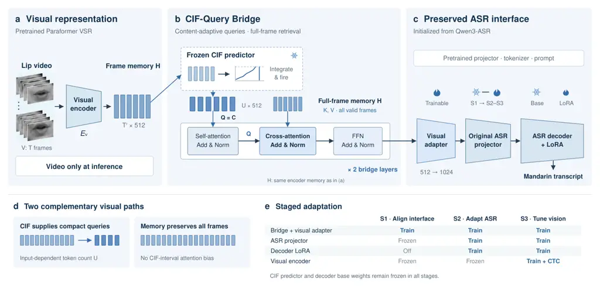

# CIF-QUERY BRIDGING FOR AUDIO-NATIVE ASR TRANSFER TO VISUAL SPEECH RECOGNITION

Chang Sun    Dongliang Xie    Wanpeng Xie    Bo Qin    Hong Yang

###### Abstract

Audio-native automatic speech recognition (ASR) models provide strong
speech-language priors, but their compact acoustic interfaces are
mismatched with long, frame-level visual features. We propose _CIF-Query
Bridge_, a lightweight connection from a Paraformer visual speech
recognition (VSR) encoder to Qwen3-ASR. The existing visual continuous
integrate-and-fire (CIF) predictor produces an input-dependent number of
token-rate queries; a two-layer cross-attention bridge refines them
against the complete frame sequence, and a linear adapter feeds the
pretrained ASR projector and decoder. This design preserves access to
uncompressed visual context while avoiding direct autoregressive
processing of hundreds of video frames. On CMLR, the complete
visual-only transfer system achieves 7.97% character error rate,
compared with 11.78% for native Paraformer under the same test split and
scoring protocol—a 3.81-point absolute and 32.3% relative reduction.
Controlled ablations characterize bridge depth, projector
initialization, adapter capacity, and CTC supervision. The results show
that CIF-derived adaptive queries provide a compact interface for
transferring audio-native ASR capability to VSR.

###### Index Terms: 

visual speech recognition, lip reading, continuous integrate-and-fire,
audio-native ASR, cross-modal transfer

^(†)^(†)address: ¹State Key Laboratory of Networking and Switching
Technology, Beijing University of Posts and Telecommunications  
²First Research Institute of The Ministry of Public Security of PRC,
Beijing 100048, China



Figure 1: Overview of CIF-Query Bridge. CIF produces token-rate queries
$`\mathbf{C}`$, while the complete visual sequence $`\mathbf{H}`$
remains cross-attention memory. The linear adapter is used in the main
system; the residual variant is ablated. Module labels show the staged
schedule.

## 1 Introduction

Visual speech recognition (VSR), also known as lip reading, transcribes
speech from visible mouth motion alone. It is valuable when audio is
unavailable or corrupted and for silent or privacy-sensitive
interaction. VSR is nevertheless intrinsically ambiguous: distinct
phonemes can share similar visemes, while coarticulation makes a visual
unit dependent on surrounding context. Early end-to-end systems such as
LipNet demonstrated joint visual feature extraction and sentence
prediction \[1\]. Mandarin presents an additional challenge because
visually similar pronunciations can correspond to different characters
and meanings. CMLR was introduced to study this large-vocabulary,
sentence-level setting \[18\].

Recent VSR advances combine stronger sequence modeling, multimodal
pretraining, and data scaling. Conformers established strong supervised
baselines \[8\]; AV-HuBERT learns masked audio-visual units \[11\];
VATLM unifies visual, audio, and text pretraining \[20\]; RAVEn
transfers raw audio-video supervision \[5\]; and Auto-AVSR scales
training with automatic transcripts \[7\]. These methods learn strong
visual encoders, but their task-specific decoders provide less
linguistic capacity for resolving visual ambiguity.

LLMs offer stronger linguistic priors. VSP-LLM maps compressed visual
speech units to an LLM \[16\]; VALLR reconstructs text from predicted
phonemes \[15\], and VALLR-Pin adds Pinyin-guided Mandarin refinement
\[13\]. Llama-AVSR uses modality projectors and LoRA to connect
audio-visual encoders to a generic LLM \[2, 6\], while MMS-LLaMA uses
rate-aware Q-Former queries \[17\]. Dynamic query allocation is
therefore not unique to our approach; here, an existing visual CIF
predictor supplies both query content and length. Unlike a generic text
LLM, an audio-native ASR model expects a compact sequence of acoustic
representations. Frame-level visual features differ in modality,
dimension, and length, so the ASR decoder’s linguistic capability cannot
be used directly without a dedicated connection.

We investigate how an audio-native ASR input interface can instead be
preserved and reused for visual-only recognition. Our _CIF-Query Bridge_
connects a pretrained Paraformer VSR encoder to Qwen3-ASR \[12\]. We
reuse, rather than redesign, the VSR model’s continuous
integrate-and-fire predictor \[3, 4\] to produce an input-dependent
number of token queries. Cross-attention refines these queries against
the complete frame-level visual memory before a small adapter and the
original ASR projector. This construction retains the speech interface
and avoids presenting hundreds of video frames directly to the
autoregressive decoder.

Our contributions are threefold. First, we propose a compact CIF-Query
Bridge that connects a pretrained VSR front end to the Qwen3-ASR
projector and decoder. Second, we use existing CIF outputs as
input-dependent queries that can attend to the complete visual sequence,
combining token-rate compression with frame-level memory. Third, we
report 7.97% CER on CMLR and study bridge depth, projector
initialization, adapter capacity, and CTC supervision under controlled
schedules.

## 2 Proposed Method

### 2.1 Architecture overview

As illustrated in Fig. 1, given a lip video $`\mathbf{V}`$ with $`T`$
frames, a pretrained visual encoder $`E_{\mathrm{v}}`$ produces

```math
\mathbf{H}=E_{\mathrm{v}}(\mathbf{V})\in\mathbb{R}^{T^{\prime}\times d_{\mathrm{v}}},\qquad d_{\mathrm{v}}=512, \tag{1}
```

where padding positions are excluded by a binary mask. The system
retains $`\mathbf{H}`$ as frame-level memory. A frozen CIF predictor
produces a shorter sequence $`\mathbf{C}`$; a two-layer bridge uses
$`\mathbf{C}`$ as queries and $`\mathbf{H}`$ as keys and values. A
visual adapter maps the bridge output to the expected acoustic feature
dimension. The resulting features pass through the original Qwen3-ASR
projector and replace the native speech placeholder in its prompt. The
tokenizer, prompt template, projector, and autoregressive decoder
therefore remain paired with their original ASR model. No audio or
audio-derived feature is required at inference.

### 2.2 CIF-query cross-attention bridge

We adopt the CIF predictor from the pretrained Paraformer VSR model
without changing its architecture. It estimates a weight $`\alpha_{t}`$
at each encoder step and integrates consecutive weighted features until
the accumulated mass reaches one. This produces

```math
\displaystyle\mathbf{C} \displaystyle=[\mathbf{c}_{u}]_{u=1}^{U}\in\mathbb{R}^{U\times d_{\mathrm{v}}}, \tag{2}
```

```math
\displaystyle U \displaystyle=\left\lfloor\sum_{t=1}^{T^{\prime}}\alpha_{t}+\tau\right\rfloor.
```

Here $`\tau=0.45`$ is the inherited tail mass appended with a zero
feature; implementation guards clip the count to the available output
length and at least one position. Both adaptation and inference use
predicted lengths, without reference-length scaling. CIF supplies query
content and count, not Qwen text-token boundaries: the original
predictor was trained with a character-plus-EOS length target. Its
outputs serve as queries with access to uncompressed visual memory.

Let $`\mathbf{Z}^{0}=\mathbf{C}`$. Bridge layer $`l`$ applies token
self-attention, cross-attention to the visual memory, and a feed-forward
network:

```math
\displaystyle\widetilde{\mathbf{Z}}^{l} \displaystyle={\rm LN}\left(\mathbf{Z}^{l-1}+{\rm MHSA}(\mathbf{Z}^{l-1})\right), \tag{3}
```

```math
\displaystyle\widehat{\mathbf{Z}}^{l} \displaystyle={\rm LN}\left(\widetilde{\mathbf{Z}}^{l}+{\rm MHA}(\widetilde{\mathbf{Z}}^{l},\mathbf{H},\mathbf{H})\right), \tag{4}
```

```math
\displaystyle\mathbf{Z}^{l} \displaystyle={\rm LN}\left(\widehat{\mathbf{Z}}^{l}+{\rm FFN}(\widehat{\mathbf{Z}}^{l})\right). \tag{5}
```

We use two layers, eight attention heads, GELU activations, and a
fourfold FFN expansion, with dropout 0.1 (omitted from the equations).
We use no CIF-interval distance bias. Predictor parameters remain
frozen, but its predicted integration weights and firing boundaries can
change when the visual encoder is updated.

### 2.3 Visual-to-ASR interface projection

The bridge produces 512-dimensional visual tokens, whereas the Qwen3-ASR
projector expects 1024-dimensional acoustic features. We resolve this
mismatch with a visual adapter $`G_{\mathrm{v}}`$. Its minimal form is a
linear map,

```math
\mathbf{a}=W_{\mathrm{v}}\mathbf{Z}^{2}+\mathbf{b}_{\mathrm{v}}, \tag{6}
```

followed by the retained two-layer ASR projector (biases omitted below)

```math
\mathbf{A}=W_{2}\,{\rm GELU}(W_{1}\mathbf{a}). \tag{7}
```

The main system uses this linear adapter. The ablation also considers a
gated residual MLP ($`1024\!\rightarrow\!2048\!\rightarrow\!1024`$,
dropout 0.1), whose sigmoid gate is initialized with $`g=-2`$.

### 2.4 Objective and staged adaptation

The autoregressive decoder is optimized with teacher-forced
cross-entropy $`\mathcal{L}_{\mathrm{AR}}`$; prompt tokens and inserted
visual positions are masked from supervision. During final
visual-encoder adaptation, its output also receives CTC supervision:

```math
\mathcal{L}=\mathcal{L}_{\mathrm{AR}}+\lambda_{\mathrm{CTC}}\mathcal{L}_{\mathrm{CTC}},\qquad\lambda_{\mathrm{CTC}}=0.1. \tag{8}
```

No CIF quantity loss is used. Freezing predictor parameters does not
guarantee invariant output lengths during visual-encoder adaptation.

Optimization proceeds in three stages. Stage 1 trains only the bridge
and visual adapter, while both pretrained backbones and the ASR
projector are frozen. Stage 2 additionally enables the original
projector and rank-16 LoRA modules in the language decoder. Stage 3
performs a short adaptation of all visual encoder blocks at a much
smaller learning rate and activates CTC. This ordering first establishes
the cross-modal interface before modifying either pretrained backbone.

## 3 Experiments

### 3.1 Dataset and implementation

We use the official CMLR split (61 hours, 11 speakers;
71,448/10,206/20,418 train/validation/test utterances) \[18\], grayscale
$`88\times 88`$ mouth crops, and CER. All our reported inputs are
visual-only. Corpus CER is the summed character edit distance divided by
the summed reference length; validation and test contain 145,832 and
292,180 reference characters. Following M2MeT, references are normalized
for spaces, annotations, punctuation, and Latin characters, while
hypotheses only have special tokens and ASR/thinking prefixes removed.

The 50-block Paraformer encoder/CIF predictor and Qwen3-ASR-1.7B
initialize the visual and language components. Training uses AdamW with
zero weight decay, bfloat16 on four GPUs, two-step gradient
accumulation, clipping at 1.0, cosine decay to 0.05 of the peak rate,
and a 500-frame/GPU batch budget. Stages 1–3 run for $`8+4+1`$ epochs.
Stage 1 uses bridge/adapter LR $`2\times 10^{-4}`$ and 1,000 warm-up
updates. Stage 2 uses LR $`2\times 10^{-5}`$ for the bridge, adapter,
projector, and LoRA, with 400 warm-up updates. Stage 3 uses LRs
$`10^{-7}`$, $`10^{-6}`$, $`10^{-5}`$, and $`5\times 10^{-6}`$ for the
encoder, CTC head, LoRA, and remaining trainable modules, respectively,
with 400 warm-up updates; it executes one epoch of an eight-epoch cosine
plan. Rank-16 LoRA uses scaling 32, dropout 0.05, and q/k/v/o plus
gate/up/down projections. Brightness, contrast, gamma, and
partition-mean temporal masking are applied only in Stage 3. Beam-8
decoding generates at most 64 tokens, without sampling or CTC rescoring.

Controlled variants use seed 42, the fixed schedule, and stage-end
checkpoints. Validation selects the two-layer linear model and chooses
the random-projector Stage 1 LR from
$`\{10^{-4},2\times 10^{-4},5\times 10^{-4}\}`$; its later stages match
the pretrained-projector run. The no-CTC run branches from the residual
model’s Stage 2 checkpoint.

### 3.2 Comparison with prior work

Table 1 compares prior work with our native baseline. “External” denotes
knowledge beyond the 61-hour CMLR training set. Our visual encoder and
CIF predictor use only CMLR. The only external source is Qwen3-ASR,
whose audio encoder is unused. The best listed result using only CMLR is
9.10% CER; 1,459 hours of AV pretraining gives 8.00%. Our 7.97% is not a
data-matched claim of superiority.

The native Paraformer baseline uses the same visual initialization
checkpoint with its original decoder, evaluated on the same test set
with the same video preprocessing and scoring protocol. It obtains
11.78% CER with beam size one, compared with 7.97% for our transferred
system with beam size eight. This is an absolute reduction of 3.81
percentage points (approximately 32.3% relative). The comparison
measures the complete transfer system, including decoder, adaptation,
and search changes; it does not isolate the CIF-query bridge.

|                          |             |        |                    |
| ------------------------ | ----------- | ------ | ------------------ |
| Method                   | External    | CMLR h | CER $`\downarrow`$ |
| CSSMCM \[18\]            | –           | 61     | 32.48              |
| LIBS \[19\]              | ASR teacher | 61     | 31.27              |
| CTCH \[10\]              | –           | 61     | 22.01              |
| JEP-KD \[14\]            | ASR teacher | 61     | 14.26              |
| Ma et al. \[9\]          | –           | 61     | 9.10               |
| Ma et al. \[9\]          | 818-h AV    | 61     | 8.10               |
| Ma et al. \[9\]          | 1459-h AV   | 61     | 8.00               |
| Native Paraformer (ours) | –           | 61     | 11.78              |
| Ours (linear adapter)    | Qwen3-ASR   | 61     | 7.97               |

Table 1: Official CMLR test CER (%); all systems use visual-only
inference. External: pretraining beyond CMLR; AV: audio-visual.

Qwen3-ASR reports 40 million hours for AuT and 3 trillion tokens for
Omni pretraining \[12\]. The stages are distinct, and their corpus
inventory and overlap with CMLR are unknown; our result therefore
measures foundation-model transfer rather than a data-matched
comparison.

### 3.3 Ablation study

Table 2 reports validation and test CER under the fixed schedule. For a
fair residual-model control, the random projector is trained from the
first Stage 1 update; validation selects $`2\times 10^{-4}`$ from
$`\{10^{-4},2\times 10^{-4},5\times 10^{-4}\}`$, and Stages 2–3 match
the pretrained run. Pretraining lowers test CER from 8.2196% to 7.9923%
(paired 95% CI $`[-0.3270,-0.1282]`$).

| Proj.  | Layers | Adapter | CTC | Val    | Test   |
| ------ | ------ | ------- | --- | ------ | ------ |
| Random | 2      | Res.    | Yes | 8.1464 | 8.2196 |
| Pretr. | 0      | Linear  | Yes | 8.1210 | 8.0820 |
| Pretr. | 1      | Linear  | Yes | 8.0140 | 7.9971 |
| Pretr. | 2      | Linear  | Yes | 7.8858 | 7.9721 |
| Pretr. | 2      | Res.    | Yes | 8.0702 | 7.9923 |
| Pretr. | 2      | Res.    | No  | 8.1018 | 8.0776 |

Table 2: Controlled CMLR ablation, CER (%). Proj.: projector
initialization; Res.: gated residual adapter. All rows use one training
seed.

With a linear adapter, depth 0-to-2 monotonically lowers validation/test
CER by 0.2352/0.1099 points; the test CI $`[-0.223,+0.005]`$ includes
zero. Linear versus residual has no clear test advantage ($`-0.0202`$;
$`[-0.106,+0.069]`$), whereas CTC lowers residual-model test CER by
0.0852 points ($`[-0.154,-0.014]`$). Figure 2 reports paired
utterance-bootstrap CIs for fixed models; they exclude seed variability,
and validation remains model-selection rather than independent evidence.

Figure 2: Paired test-CER differences with 95% utterance-bootstrap CIs
(10,000 samples); negative values favor the first configuration.

## 4 Discussion

The 3.81-point complete-system gain likely reflects primarily the
Qwen3-ASR decoder and its linguistic prior. This does not make the
connection secondary: the ASR backend expects a short sequence of
1024-dimensional acoustic representations, whereas the visual front end
emits a much longer sequence of 512-dimensional features. Without
adaptive rate compression, dimensional alignment, and access to
frame-level memory, the decoder’s pretrained capability cannot be
applied to visual input. Our contribution is this connection rather than
the decoder itself. Moreover, the native comparison changes the decoder,
adaptation, and beam search, so it measures the complete transfer system
and does not isolate the bridge’s causal contribution.

Within the controlled runs, the monotonic depth trend on both splits is
consistent with full-memory retrieval recovering context that token-rate
CIF integration may discard. The test interval nevertheless includes
zero, and depth also changes capacity and optimization. Equal-length
pooled or learned queries and a matched-capacity no-memory control are
needed to identify the source of the trend. Although CIF parameters
remain frozen, Stage 3 changes their encoder inputs and can shift firing
weights, boundaries, and predicted lengths; measuring this drift and its
relation to CER is another useful test.

Evidence remains limited to one seed, CMLR, and one Paraformer–Qwen3-ASR
pairing. Historical test feedback weakens independent confirmation, and
the overlap between foundation-model pretraining and CMLR is unknown.
Multiple seeds, a matched text-LLM baseline, and independent datasets
are needed to establish stability and generalization.

## 5 Conclusion

We proposed CIF-Query Bridge, which uses adaptive CIF outputs as
token-rate queries over complete visual memory before the original
audio-native ASR interface. Combining content-adaptive compression with
full-memory retrieval avoids presenting one LLM token per video frame
while retaining fine temporal evidence. It also preserves the
model-specific tokenizer, prompt, and projector rather than learning an
unrelated text-LLM input space. The resulting visual-only
Paraformer–Qwen3-ASR system achieves 7.97% CER on CMLR, compared with
11.78% for native Paraformer under the same split and scoring protocol.
Controlled results show a consistent bridge-depth trend and delimit the
smaller effects of auxiliary components. They establish the feasibility
of the connection; future work should add multiple seeds, matched-query
controls, and evaluation on unseen datasets and languages.

## References

- \[1\] Y. M. Assael, B. Shillingford, S. Whiteson, and N. de
  Freitas (2016) LipNet: end-to-end sentence-level lipreading. arXiv
  preprint arXiv:1611.01599. Cited by: §1.
- \[2\] U. Cappellazzo, M. Kim, H. Chen, P. Ma, S. Petridis, D.
  Falavigna, A. Brutti, and M. Pantic (2025) Large language models are
  strong audio-visual speech recognition learners. In Proc. IEEE
  International Conference on Acoustics, Speech and Signal Processing,
  pp. 1–5. External Links:
  [Document](https://dx.doi.org/10.1109/ICASSP49660.2025.10889251) Cited
  by: §1.
- \[3\] L. Dong and B. Xu (2020) CIF: continuous integrate-and-fire for
  end-to-end speech recognition. In Proc. IEEE International Conference
  on Acoustics, Speech and Signal Processing, pp. 6079–6083. External
  Links: [Document](https://dx.doi.org/10.1109/ICASSP40776.2020.9053850)
  Cited by: §1.
- \[4\] Z. Gao, S. Zhang, I. McLoughlin, and Z. Yan (2022) Paraformer:
  fast and accurate parallel transformer for non-autoregressive
  end-to-end speech recognition. In Proc. Interspeech, pp. 2063–2067.
  External Links:
  [Document](https://dx.doi.org/10.21437/Interspeech.2022-9996) Cited
  by: §1.
- \[5\] A. Haliassos, P. Ma, R. Mira, S. Petridis, and M. Pantic (2023)
  Jointly learning visual and auditory speech representations from raw
  data. In Proc. IEEE/CVF International Conference on Computer Vision,
  pp. 10006–10017. Cited by: §1.
- \[6\] E. J. Hu, Y. Shen, P. Wallis, Z. Allen-Zhu, Y. Li, S. Wang, L.
  Wang, and W. Chen (2022) LoRA: low-rank adaptation of large language
  models. In Proc. International Conference on Learning Representations,
  Cited by: §1.
- \[7\] P. Ma, A. Haliassos, A. Fernandez-Lopez, H. Chen, S. Petridis,
  and M. Pantic (2023) Auto-AVSR: audio-visual speech recognition with
  automatic labels. In Proc. IEEE International Conference on Acoustics,
  Speech and Signal Processing, pp. 1–5. External Links:
  [Document](https://dx.doi.org/10.1109/ICASSP49357.2023.10096889) Cited
  by: §1.
- \[8\] P. Ma, S. Petridis, and M. Pantic (2021) End-to-end audio-visual
  speech recognition with conformers. In Proc. IEEE International
  Conference on Acoustics, Speech and Signal Processing, pp. 7613–7617.
  External Links:
  [Document](https://dx.doi.org/10.1109/ICASSP39728.2021.9414567) Cited
  by: §1.
- \[9\] P. Ma, S. Petridis, and M. Pantic (2022) Visual speech
  recognition for multiple languages in the wild. Nature Machine
  Intelligence 4 (11), pp. 930–939. External Links:
  [Document](https://dx.doi.org/10.1038/s42256-022-00550-z) Cited by:
  Table 1, Table 1, Table 1.
- \[10\] S. Ma, S. Wang, and X. Lin (2020) A transformer-based model for
  sentence-level chinese mandarin lipreading. In Proc. IEEE
  International Conference on Data Science in Cyberspace, pp. 78–81.
  External Links:
  [Document](https://dx.doi.org/10.1109/DSC50466.2020.00020) Cited by:
  Table 1.
- \[11\] B. Shi, W. Hsu, K. Lakhotia, and A. Mohamed (2022) Learning
  audio-visual speech representation by masked multimodal cluster
  prediction. In Proc. International Conference on Learning
  Representations, Cited by: §1.
- \[12\] X. Shi, X. Wang, Z. Guo, Y. Wang, P. Zhang, X. Zhang, Z.
  Guo, H. Hao, Y. Xi, B. Yang, J. Xu, J. Zhou, and J. Lin (2026)
  Qwen3-ASR technical report. arXiv preprint arXiv:2601.21337. Cited by:
  §1, §3.2.
- \[13\] C. Sun, D. Xie, B. Qin, and H. Yang (2025) VALLR-Pin:
  dual-decoding visual speech recognition for mandarin with
  pinyin-guided LLM refinement. arXiv preprint arXiv:2512.20032. Cited
  by: §1.
- \[14\] C. Sun, H. Yang, and B. Qin (2024) JEP-KD: joint-embedding
  predictive architecture based knowledge distillation for visual speech
  recognition. IEEE Open Journal of Signal Processing. External Links:
  [Document](https://dx.doi.org/10.1109/OJSP.2024.3496819) Cited by:
  Table 1.
- \[15\] M. Thomas, E. Fish, and R. Bowden (2025) VALLR: visual ASR
  language model for lip reading. arXiv preprint arXiv:2503.21408. Cited
  by: §1.
- \[16\] J. H. Yeo, S. Han, M. Kim, and Y. M. Ro (2024) Where visual
  speech meets language: VSP-LLM framework for efficient and
  context-aware visual speech processing. In Findings of the Association
  for Computational Linguistics: EMNLP 2024, pp. 11391–11406. External
  Links:
  [Document](https://dx.doi.org/10.18653/v1/2024.findings-emnlp.666)
  Cited by: §1.
- \[17\] J. H. Yeo, H. Rha, S. J. Park, and Y. M. Ro (2025) MMS-LLaMA:
  efficient LLM-based audio-visual speech recognition with minimal
  multimodal speech tokens. In Findings of the Association for
  Computational Linguistics: ACL 2025, pp. 20724–20735. External Links:
  [Document](https://dx.doi.org/10.18653/v1/2025.findings-acl.1065)
  Cited by: §1.
- \[18\] Y. Zhao, R. Xu, and M. Song (2019) A cascade
  sequence-to-sequence model for chinese mandarin lip reading. In Proc.
  ACM Multimedia Asia, pp. 1–6. External Links:
  [Document](https://dx.doi.org/10.1145/3338533.3366579) Cited by: §1,
  §3.1, Table 1.
- \[19\] Y. Zhao, R. Xu, X. Wang, P. Hou, H. Tang, and M. Song (2020)
  Hearing lips: improving lip reading by distilling speech recognizers.
  In Proc. AAAI Conference on Artificial Intelligence, Vol. 34,
  pp. 6917–6924. External Links:
  [Document](https://dx.doi.org/10.1609/aaai.v34i04.6174) Cited by:
  Table 1.
- \[20\] Q. Zhu, L. Zhou, Z. Zhang, S. Liu, B. Jiao, J. Zhang, L.
  Dai, D. Jiang, J. Li, and F. Wei (2024) VATLM: visual-audio-text
  pre-training with unified masked prediction for speech representation
  learning. IEEE Transactions on Multimedia 26, pp. 1055–1064. External
  Links: [Document](https://dx.doi.org/10.1109/TMM.2023.3275873) Cited
  by: §1.
